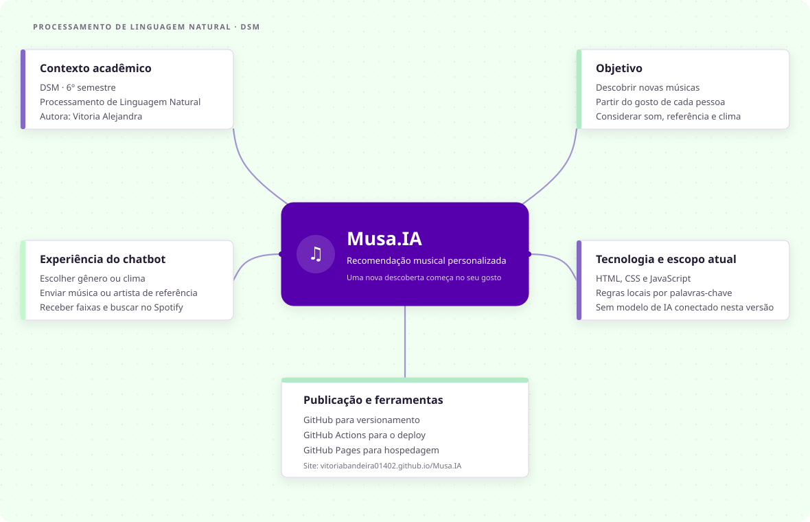

# Musa.IA

### Recomendações musicais a partir do seu gosto

**DSM · 6º semestre**  
**Disciplina:** Processamento de Linguagem Natural  
**Autora:** Vitoria Alejandra

---

## Descrição do projeto

A **Musa.IA** é um protótipo de recomendação musical pensado para ajudar cada pessoa a descobrir novas faixas a partir do que já gosta. A proposta é permitir que o usuário escolha um estilo, informe um artista ou uma música de referência, ou descreva o clima que deseja ouvir. A partir disso, a Musa apresenta sugestões relacionadas e atalhos para pesquisar as faixas no Spotify.

O projeto busca tornar a descoberta musical mais pessoal e conversacional: em vez de depender apenas de categorias, a pessoa pode começar por uma música ou por uma sensação.

> **Estado da integração:** o chat do site permanece uma demonstração local por palavras-chave. Foi preparado um workflow n8n importável que encaminha mensagens do Telegram ao Dialogflow ES e devolve a resposta ao mesmo chat. Para ativá-lo, ainda é preciso configurar o bot, o agente e as credenciais no n8n; não há credenciais ou tokens neste repositório. O Dialogflow interpreta a mensagem, mas as respostas dependem dos intents e fulfillments configurados no agente.

## Integração Telegram + Dialogflow

- [Workflow n8n para importar](../integracoes/musa-telegram-dialogflow.json).
- [Guia de configuração e teste](./Configurar-Telegram-Dialogflow.md).

O fluxo é: Telegram Trigger → Dialogflow ES `detectIntent` → envio da resposta pelo Telegram. O chat embutido no site ainda não está ligado ao bot; após criar o bot, o botão de acesso poderá apontar para o username dele.

## Mapa mental

O diagrama resume o objetivo, a experiência do usuário, as tecnologias e o estado atual do projeto.

[ Abrir o mapa mental em tamanho completo ](./mapa-mental.svg)

## Site de divulgação e chatbot

[Acessar a Musa.IA no GitHub Pages](https://vitoriabandeira01402.github.io/Musa.IA/)

O chatbot fica na seção **Experimente** da página. A conversa de demonstração é local e apresenta recomendações de exemplo; os botões de cada faixa abrem uma busca correspondente no Spotify.

## Ferramentas utilizadas

| Ferramenta | Uso no projeto |
| --- | --- |
| HTML5 | Estrutura semântica da página e do documento. |
| CSS3 | Identidade visual, responsividade, animações e acessibilidade visual. |
| JavaScript | Interações do chat, seleção de gênero e recomendações demonstrativas por palavras-chave. |
| Google Fonts | Tipografia Fraunces e DM Sans. |
| Git e GitHub | Versionamento e hospedagem do código-fonte. |
| GitHub Actions | Automatização do fluxo de publicação. |
| GitHub Pages | Hospedagem gratuita da página estática. |
| Spotify | Destino dos links de busca das faixas recomendadas. |
| n8n | Orquestração do fluxo entre Telegram e Dialogflow. |
| Dialogflow ES | Interpretação de intents e geração das respostas configuradas para a conversa. |

## Referências

- Página usada como referência visual: [Vitória — inclusão digital](https://landing-page-da-vitoria--pdanib.replit.app/).
- Página publicada do projeto: [Musa.IA — GitHub Pages](https://vitoriabandeira01402.github.io/Musa.IA/).
- Código-fonte e fluxo de publicação: [repositório Musa.IA](https://github.com/vitoriabandeira01402/Musa.IA).
- Documentação oficial: [GitHub Pages](https://docs.github.com/pages).
- Busca de músicas: [Spotify](https://open.spotify.com/).
- Famílias tipográficas: [Fraunces](https://fonts.google.com/specimen/Fraunces) e [DM Sans](https://fonts.google.com/specimen/DM+Sans), via Google Fonts.

---

**Musa.IA · Processamento de Linguagem Natural · DSM**
